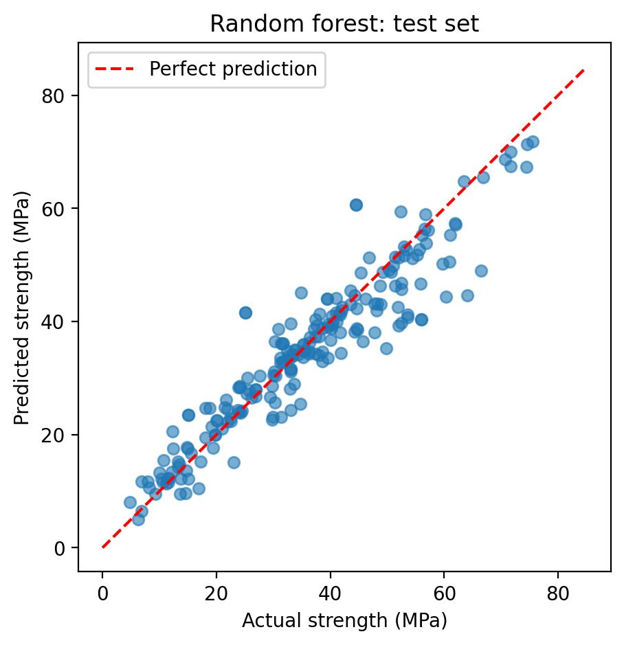
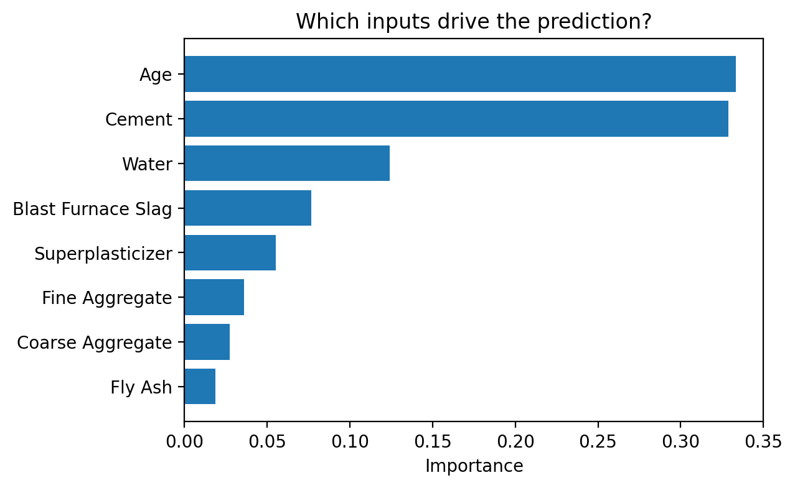

# Predicting Concrete Compressive Strength with Machine Learning

**Author:** Shruthi Thiyagarajan
**Course:** CV7001 Machine Learning Mini-Project

[](https://colab.research.google.com/github/Shru-Lab/CV7001-ML-Assignment/blob/main/CV7001_ML_Assignment.ipynb)

## 1. Problem

In structural engineering, the compressive strength of concrete is normally confirmed by crushing test cylinders after 28 days of curing. Trial batches and waiting times slow down mix design, especially for mixes that use supplementary materials such as fly ash and blast furnace slag, whose effect on strength is harder to estimate by rule of thumb.

This project trains a model that **predicts compressive strength directly from the mix design and the age of the concrete**, so candidate mixes can be screened before casting.

- **Task:** regression, using a random forest model (with linear regression as a baseline)
- **Inputs (8):** cement, blast furnace slag, fly ash, water, superplasticizer, coarse aggregate, fine aggregate (all in kg/m³), and age (days)
- **Output:** compressive strength (MPa)

## 2. Dataset

**Concrete Compressive Strength** dataset by I-Cheng Yeh, from the UCI Machine Learning Repository: 1,030 laboratory-tested concrete mixes, 8 input columns and 1 target column, no missing values.

- Dataset page: https://archive.ics.uci.edu/dataset/165/concrete+compressive+strength
- **The data is not stored in this repository.** The notebook downloads it automatically from UCI using the `ucimlrepo` package (`fetch_ucirepo(id=165)`).
- Backup: if the automatic download fails, download the zip from the dataset page above; it contains `Concrete_Data.xls` with the same data.

No labels were created by the author; the strength values are the original laboratory measurements.

## 3. Method

| Step | Details |
|---|---|
| Data split | 80% training (824 mixes) / 20% test (206 mixes), `train_test_split(..., test_size=0.2, random_state=42)` |
| Baseline model | Linear regression (scikit-learn `LinearRegression`, default settings) |
| Main model | Random forest (scikit-learn `RandomForestRegressor`, `n_estimators=300`, `random_state=42`) |
| Hyperparameters | No tuning was performed: 300 trees, with all other settings at scikit-learn defaults. Tuning (e.g. tree depth or minimum leaf size) is a possible improvement. |
| Validation | 5-fold cross-validation on the training set only |
| Test | Final evaluation on the held-out test set, which is never used for training |
| Metrics | Mean absolute error (MAE), root mean squared error (RMSE), and R² |

No preprocessing was needed: the dataset has no missing values, and random forests do not require feature scaling.

## 4. Results

| Model | Validation MAE (5-fold CV) | Test MAE | Test RMSE | Test R² |
|---|---|---|---|---|
| Linear regression (baseline) | 8.44 ± 0.75 MPa | 7.75 MPa | 9.80 MPa | 0.628 |
| Random forest | 3.60 ± 0.16 MPa | 3.79 MPa | 5.54 MPa | 0.881 |

The random forest roughly halves the prediction error of the linear baseline. The validation and test errors are close, which indicates the result is stable 

**Predicted vs. actual strength (test set):**



Predictions are tight for low and medium strengths (test MAE of 3.0 MPa below 30 MPa and 3.4 MPa between 30 and 50 MPa). Above 50 MPa the MAE rises to 5.9 MPa with a mean signed error of −5.4 MPa, so the model systematically underpredicts high-strength mixes. Only 20% of training mixes exceed 50 MPa, and because a random forest predicts by averaging training examples, these scarce extreme values are pulled towards the middle of the range. The test set stays within the training range (maximum 75.5 vs. 82.6 MPa), so extrapolation is not the cause. This analysis is in Step 5b of the notebook.

**Feature importance:**



Age and cement content are the most influential inputs, followed by water. This agrees with established concrete technology (strength gain with curing time, binder content, and the water–cement ratio). Note that importance reflects what the model relies on, not causation.

## 5. Repository contents

| File | Description |
|---|---|
|`CV7001_ML_Assignment.ipynb` | Full pipeline: data download, split, training, evaluation, figures, saving the model, and an example prediction |
| `concrete_rf.joblib` | Trained random forest model |
| `pred_vs_actual.png`, `feature_importance.png` | Figures produced by the notebook |
| `requirements.txt` | Python packages and versions |

## 6. How to reproduce

### Software requirements

The packages below are listed in `requirements.txt`. The versions are those used to produce the reported results.

| Package | Version | Purpose |
|---|---|---|
| Python | 3.13.18 | Programming language |
| scikit-learn | 1.6.1 | Train/test split, models, cross-validation and metrics |
| pandas | 2.2.3 | Handling the tabular data |
| numpy | 2.4.6 | Numerical calculations |
| matplotlib | 3.10.0 | Plotting the figures |
| joblib | 1.6.0 | Saving and loading the trained model |
| ucimlrepo | latest | Downloading the dataset from UCI |

Install them with `pip install -r requirements.txt` (not needed in Google Colab, where all but `ucimlrepo` are pre-installed and the notebook installs `ucimlrepo` itself).

### Option A: Google Colab 

1. Click the **Open in Colab** badge at the top of this page.
2. In Colab, choose **Runtime → Run all**.
3. The notebook installs `ucimlrepo`, downloads the data, trains both models, prints all metrics, creates both figures, saves `concrete_rf.joblib`, and makes an example prediction.

### Option B: Run locally

Requires Python 3.13 (other recent versions will likely work).

```bash
git clone https://github.com/Shru-Lab/CV7001-ML-Assignment.git
cd CV7001-ML-Assignment
pip install -r requirements.txt
pip install notebook
jupyter notebook CV7001_ML_Assignment.ipynb
```

Then run all cells from top to bottom (**Run → Run All Cells**). An internet connection is needed for the data download.

### Retraining

Running the notebook from top to bottom retrains both models from scratch and overwrites `concrete_rf.joblib`. Training takes a few seconds.

## 7. Using the trained model on a new mix

The last cells of the notebook load the saved model and predict the strength of a new mix. The same can be done in any Python script:

```python
import joblib
import pandas as pd

model = joblib.load("concrete_rf.joblib")

columns = ["Cement", "Blast Furnace Slag", "Fly Ash", "Water",
           "Superplasticizer", "Coarse Aggregate", "Fine Aggregate", "Age"]

# kg/m³ for the first seven inputs, days for age
new_mix = pd.DataFrame([[350, 0, 0, 175, 5, 1000, 800, 28]], columns=columns)

print(f"Predicted strength: {model.predict(new_mix)[0]:.1f} MPa")
```

Expected output with the provided model: `Predicted strength: 48.7 MPa`

## 8. Reproducibility details

- **Environment:** Google Colab, Python 3.13.18, scikit-learn 1.6.1, pandas 2.2.3, numpy 2.4.6, matplotlib 3.10.0, joblib 1.6.0
- **Random seed:** 42 for both the train/test split and the random forest
- **Data split:** 80/20 train/test; cross-validation uses the training set only
- Results may differ very slightly with other library versions. The saved model file should be loaded with the same scikit-learn version it was created with (1.6.1).

## 9. Limitations

- The model is less accurate for high-strength concrete (above about 50 MPa) and tends to underpredict it.
- It is only reliable within the range of mixes in the dataset; it should not be used for unusual materials or proportions.
- An average error of about 4 MPa is useful for screening mix designs but does not replace standard cylinder testing for design or acceptance.

## 10. References

1. Yeh, I-C. (1998). *Concrete Compressive Strength* [Dataset]. UCI Machine Learning Repository. https://doi.org/10.24432/C5PK67
2. Yeh, I-C. (1998). Modeling of strength of high-performance concrete using artificial neural networks. *Cement and Concrete Research*, 28(12), 1797–1808.
3. Pedregosa, F. et al. (2011). Scikit-learn: Machine Learning in Python. *Journal of Machine Learning Research*, 12, 2825–2830.

## 11. Acknowledgements and AI disclosure

This project uses the scikit-learn, pandas, numpy, matplotlib, joblib, and ucimlrepo libraries. No pretrained models were used. Generative AI (Claude, by Anthropic) was used for guidance writing the code; all code was run and all results were checked by the author.
